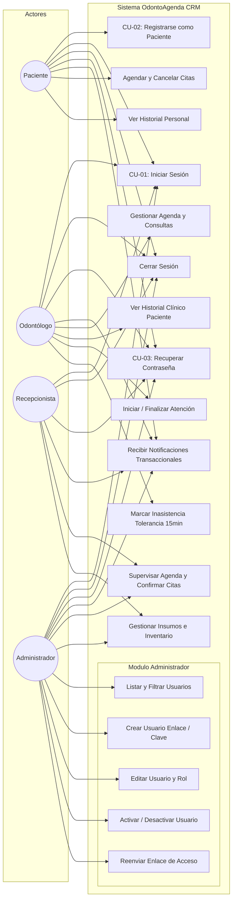
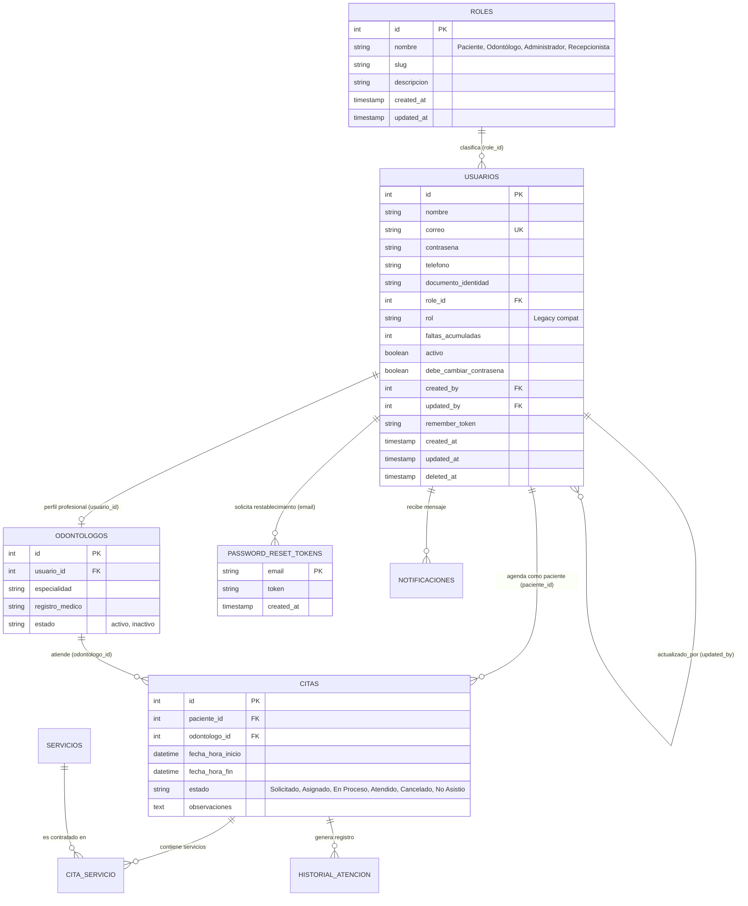
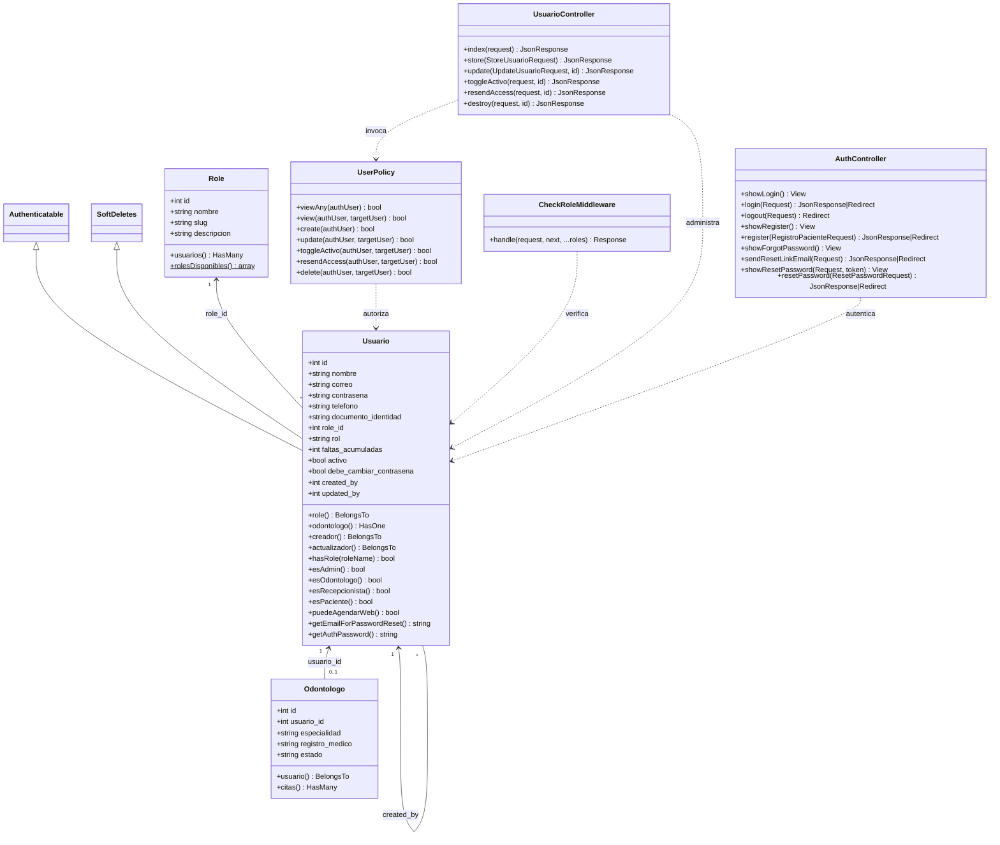
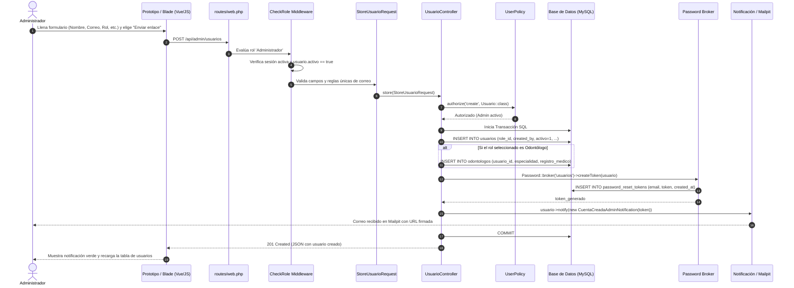
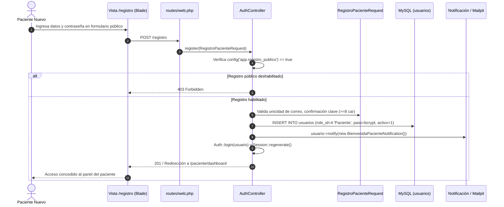
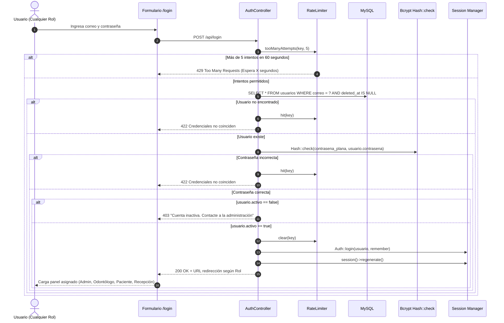

# Módulo de Autenticación, Roles, Gestión de Usuarios y Notificaciones
## OdontoAgenda CRM (DentalCare)
**Rama:** `feature/auth-roles-correo`  
**Fecha:** Noviembre 2026  
**Versión del Sistema:** 2.0 (Laravel 11 / PHP 8.2 / MySQL 8.0)

---

## 1. Introducción y Alcance
Este documento describe formalmente la especificación funcional, arquitectura de seguridad, casos de uso, matriz de permisos y diagramas técnicos del subsistema de autenticación, autorización basada en roles (RBAC), administración de usuarios y notificaciones transaccionales por correo electrónico implementados en **OdontoAgenda CRM**.

### Roles Definitivos del Sistema
1. **Paciente**: Usuario receptor de tratamientos odontológicos. Puede registrarse públicamente si la clínica lo habilita, agendar citas en línea, cancelar citas con antelación, ver su historial de atenciones y recibir confirmaciones/cancelaciones por correo.
2. **Odontólogo**: Profesional de la salud bucal. Consulta su agenda diaria, atiende citas, consulta el historial clínico del paciente antes y durante la atención, finaliza consultas con diagnósticos y registra inasistencias tras la ventana de tolerancia.
3. **Recepcionista**: Personal administrativo de apoyo clínico. Gestiona y supervisa la agenda global, confirma citas de pacientes, gestiona el inventario e insumos clínicos y atiende consultas operativas.
4. **Administrador**: Máxima autoridad del sistema. Posee acceso irrestricto a métricas gerenciales, inventario, agenda general y es el **único rol autorizado** para acceder al módulo de **Gestión de Usuarios** (creación, edición, activación/desactivación y reenvío de accesos).

---

## 2. Requerimientos del Sistema

### 2.1 Requerimientos Funcionales (RF)
- **RF-01 (Autenticación real):** El sistema debe permitir el inicio de sesión validando credenciales contra la base de datos MySQL con contraseñas cifradas en BCrypt. No se permiten datos ni contraseñas quemadas.
- **RF-02 (Rate Limiting en Login):** El sistema debe bloquear temporalmente las solicitudes de inicio de sesión tras 5 intentos fallidos consecutivos en una ventana de 60 segundos por IP/usuario.
- **RF-03 (Control de estado activo):** Un usuario desactivado (`activo = 0` o SoftDeleted) no puede iniciar sesión. Si un usuario es desactivado mientras mantiene una sesión activa, el sistema debe invalidar su sesión inmediatamente en su próxima petición.
- **RF-04 (Redirección inteligente por rol):** Al autenticarse satisfactoriamente, el sistema redirige automáticamente al usuario según su rol:
  - Administrador -> `/admin/dashboard`
  - Odontólogo -> `/odontologo/agenda`
  - Recepcionista -> `/admin/agenda`
  - Paciente -> `/paciente/dashboard`
- **RF-05 (Cierre de sesión seguro):** El logout debe revocar la autenticación, invalidar la sesión HTTP y regenerar el token CSRF.
- **RF-06 (Registro público condicionado):** Los pacientes pueden registrarse desde el formulario público si y solo si la variable de entorno `REGISTRO_PUBLICO=true`. El formulario asigna única y forzosamente el rol **Paciente**.
- **RF-07 (Recuperación de contraseña con token):** El sistema debe implementar recuperación de contraseñas mediante el Password Broker nativo de Laravel (`password_reset_tokens`), con expiración configurable (60 min) y enlace firmado.
- **RF-08 (Protección de enumeración de usuarios):** La solicitud de restablecimiento de contraseña no debe revelar si el correo electrónico existe o no en la base de datos.
- **RF-09 (Módulo de Gestión de Usuarios):** Disponible exclusivamente para el rol Administrador. Permite:
  - Listar usuarios con paginación (10 por página), búsqueda en tiempo real por texto (nombre, correo, cédula) y filtros combinables por Rol y Estado.
  - Crear usuarios de cualquier rol (Administrador, Odontólogo, Recepcionista, Paciente) con creación automática del registro complementario en `odontologos` si aplica.
  - Seleccionar método de clave: **a)** Enlace seguro de activación enviado por correo (por defecto), o **b)** Contraseña manual con marca forzada de cambio en primer inicio de sesión (`debe_cambiar_contrasena = 1`).
  - Editar datos de perfil y rol.
  - Activar / Desactivar usuarios sin eliminarlos físicamente.
  - Reenviar enlaces de activación por correo electrónico.
  - Eliminación lógica mediante `SoftDeletes`.
- **RF-10 (Notificaciones por correo):** El sistema debe despachar notificaciones transaccionales en español:
  - Bienvenida al paciente registrado.
  - Cuenta creada por Administrador (con botón de acceso/definición de clave).
  - Enlace de recuperación de contraseña.
  - Confirmación de cita agendada.
  - Cancelación de cita médica.

### 2.2 Requerimientos No Funcionales de Seguridad (RNF-SEG)
- **RNF-SEG-01 (Hash criptográfico):** Todas las contraseñas se almacenan mediante el algoritmo `bcrypt` con costo de factor 12 en producción y 4 en pruebas automatizadas.
- **RNF-SEG-02 (Protección CSRF):** Todas las peticiones mutables (`POST`, `PUT`, `PATCH`, `DELETE`) exigen token CSRF válido vía header `X-CSRF-TOKEN` o campo oculto `_token`.
- **RNF-SEG-03 (Autorización multi-nivel):** La seguridad se aplica en capas redundantes: Middleware HTTP de roles (`CheckRole`), Políticas de Autorización (`UserPolicy`) y Form Requests (`StoreUsuarioRequest`, `UpdateUsuarioRequest`).
- **RNF-SEG-04 (Regla de oro de Administración):**
  - Un Administrador no puede desactivarse a sí mismo.
  - Un Administrador no puede retirarse su propio rol de Administrador.
  - El sistema nunca puede quedar sin al menos un Administrador activo.
- **RNF-SEG-05 (Auditoría de cambios):** La tabla `usuarios` almacena la trazabilidad de autoría con `created_by` y `updated_by` apuntando al ID del usuario que realizó la operación.

---

## 3. Matriz de Permisos por Rol

| Módulo / Funcionalidad | Paciente | Odontólogo | Recepcionista | Administrador | Mecanismo de Control |
|---|:---:|:---:|:---:|:---:|---|
| **Registro Público Web** |  (Público) |  |  |  | `REGISTRO_PUBLICO=true`, FormRequest `RegistroPacienteRequest` |
| **Inicio de Sesión (Login)** |  |  |  |  | `AuthController::login` con rate-limiting y validación de activo |
| **Recuperar Contraseña** |  |  |  |  | `PasswordBroker`, sin revelar existencia |
| **Dashboard Paciente** |  |  |  |  | Middleware `role:Paciente` |
| **Agendar Citas Online** |  (<= 1 falta) |  |  |  | Regla de negocio inasistencias < 2 |
| **Cancelar Cita Propia** |  (>= 2h antes) |  |  |  | Regla de anticipación mínima 2 horas |
| **Consultar Historial Propio** |  |  |  |  | Filtrado por `usuario_id` autenticado |
| **Agenda Odontológica** |  |  |  |  | Middleware `role:Odontólogo` |
| **Ver Historial Clínico Paciente** |  |  |  |  | Middleware `role:Odontólogo,Administrador` |
| **Iniciar / Finalizar Atención** |  |  |  |  | Middleware `role:Odontólogo` |
| **Registrar Inasistencia (No Asistió)** |  |  |  |  | Ventana de tolerancia >= 15 min |
| **Gestión de Citas General** |  |  |  |  | Middleware `role:Administrador,Recepcionista` |
| **Gestión de Insumos e Inventario**|  |  |  |  | Middleware `role:Administrador,Recepcionista` |
| **Métricas y Reportes Gerenciales**|  |  |  |  | Middleware `role:Administrador,Recepcionista` |
| **Listar Usuarios del Sistema** |  |  |  |  | Middleware `role:Administrador` + `UserPolicy@viewAny` |
| **Crear Usuarios (Cualquier Rol)** |  |  |  |  | Middleware `role:Administrador` + `UserPolicy@create` |
| **Editar Datos y Roles de Usuario**|  |  |  |  | Middleware `role:Administrador` + `UserPolicy@update` |
| **Activar / Desactivar Usuarios** |  |  |  |  | Middleware `role:Administrador` + `UserPolicy@toggleActivo` |
| **Reenviar Acceso por Correo** |  |  |  |  | Middleware `role:Administrador` + `UserPolicy@resendAccess` |
| **Eliminación Lógica (SoftDelete)**|  |  |  |  | Middleware `role:Administrador` + `UserPolicy@delete` |

---

## 4. Especificación Detallada de Casos de Uso

### CU-01: Iniciar Sesión en la Plataforma
- **Actores:** Paciente, Odontólogo, Recepcionista, Administrador.
- **Precondiciones:** El usuario debe tener una cuenta registrada y activa en el sistema.
- **Flujo Principal:**
  1. El actor ingresa a `/login`.
  2. El sistema presenta formulario con correo electrónico, contraseña y opción "Recordar sesión".
  3. El actor ingresa sus credenciales y presiona "Iniciar Sesión".
  4. El sistema comprueba el limitador de tasa (máximo 5 intentos por minuto).
  5. El sistema busca el usuario por `correo` activo (`deleted_at IS NULL`).
  6. El sistema valida el hash de la contraseña mediante `Hash::check()`.
  7. El sistema verifica que `activo == true`.
  8. El sistema regenera el identificador de sesión para prevenir ataques de Session Fixation.
  9. Si `debe_cambiar_contrasena == true`, el sistema muestra advertencia de actualización obligatoria.
  10. El sistema redirige al panel correspondiente según el rol del usuario.
- **Flujos Alternos:**
  - *4a. Límite de intentos superado:* El sistema bloquea el acceso temporalmente y retorna HTTP 429 con mensaje "Demasiados intentos de acceso. Intente nuevamente en X segundos".
  - *5a/6a. Credenciales inválidas:* El sistema retorna error genérico "Las credenciales ingresadas no coinciden con nuestros registros".
  - *7a. Usuario inactivo:* El sistema revoca la autenticación y muestra mensaje: "Su cuenta se encuentra inactiva. Comuníquese con la administración".

---

### CU-02: Registrarse como Paciente (Público)
- **Actores:** Paciente.
- **Precondiciones:** La configuración del sistema debe tener `REGISTRO_PUBLICO=true`.
- **Flujo Principal:**
  1. El paciente accede a la URL `/registro`.
  2. El sistema valida que el registro público esté encendido en `config('app.registro_publico')`.
  3. El paciente diligencia su Nombre, Correo, Teléfono, Documento de Identidad, Contraseña (mínimo 8 caracteres) y Confirmación de contraseña.
  4. El paciente presiona "Crear Cuenta".
  5. El sistema valida los datos mediante `RegistroPacienteRequest`.
  6. El sistema crea el registro en la tabla `usuarios` forzando `role_id = 4` (`Paciente`), `activo = 1`, `faltas_acumuladas = 0`.
  7. El sistema despacha la notificación `BienvenidaPacienteNotification` al correo del paciente.
  8. El sistema inicia la sesión del paciente de forma automática.
  9. El sistema redirige al paciente a su panel `/paciente/dashboard`.
- **Flujos Alternos:**
  - *2a. Registro público desactivado:* El sistema redirige a `/login` con mensaje informativo y rechaza cualquier solicitud HTTP directa con código 403.
  - *5a. Correo ya registrado:* El sistema rechaza la solicitud indicando que el correo electrónico ya se encuentra en uso.

---

### CU-03: Recuperar Contraseña
- **Actores:** Paciente, Odontólogo, Recepcionista, Administrador.
- **Precondiciones:** Ninguna (puede realizarse sin sesión activa).
- **Flujo Principal:**
  1. El actor ingresa a `/olvide-contrasena`.
  2. El actor ingresa su correo y presiona "Enviar enlace de recuperación".
  3. El sistema busca el usuario. Si existe y está activo, genera un token criptográfico seguro mediante `Password::broker('usuarios')->createToken($usuario)` y envía la notificación `RecuperarContrasenaNotification`.
  4. El sistema siempre responde con el mismo mensaje de éxito neutro: "Si tu correo coincide con una cuenta activa, te hemos enviado un enlace".
  5. El usuario abre su correo (Mailpit o cliente de correo) y hace clic en el enlace con el token firmado.
  6. El sistema abre la vista `/recuperar-contrasena/{token}`.
  7. El usuario escribe su nueva contraseña (mínimo 8 caracteres) y su confirmación.
  8. El sistema valida el token contra `password_reset_tokens`.
  9. El sistema actualiza `contrasena` con el nuevo hash BCrypt, desmarca `debe_cambiar_contrasena = 0` y borra el token utilizado.
  10. El sistema redirige al usuario a `/login` con mensaje de éxito.
- **Flujos Alternos:**
  - *8a. Token inválido o expirado (>60 minutos):* El sistema informa del error y solicita generar un nuevo enlace.

---

### CU-04: Gestionar Usuarios (Administrador)
- **Actores:** Administrador.
- **Precondiciones:** Estar autenticado con el rol `Administrador` y estado activo.
- **Flujo Principal (Creación con Enlace Seguro):**
  1. El Administrador navega a la sección "Gestión de Usuarios".
  2. El sistema muestra la tabla con listado paginado, contadores de roles y buscador.
  3. El Administrador presiona "+ Nuevo Usuario".
  4. El Administrador diligencia: Nombre completo, Correo electrónico, Teléfono, Documento, Rol (`Administrador`, `Odontólogo`, `Recepcionista` o `Paciente`), Estado (`Activo`) y selecciona el método de contraseña: **"Enviar enlace seguro por correo"**.
  5. Si el rol es `Odontólogo`, el sistema despliega los campos requeridos: `Especialidad` y `Registro Médico`.
  6. El Administrador presiona "Guardar y Enviar Acceso".
  7. El sistema valida los datos con `StoreUsuarioRequest`.
  8. El sistema inserta el registro en `usuarios` vinculando `role_id`, `created_by` con el ID del Administrador y `contrasena` con hash temporal aleatorio.
  9. Si es odontólogo, crea la fila correspondiente en la tabla `odontologos`.
  10. El sistema genera un token con `Password::broker` y despacha la notificación `CuentaCreadaAdminNotification`.
  11. La tabla de usuarios se actualiza dinámicamente y el nuevo usuario queda listado.
- **Flujo Alterno (Creación con Clave Manual):**
  - En el paso 4, el Administrador selecciona **"Definir contraseña inicial manualmente"**, escribe la contraseña (>= 8 caracteres) y marca o deja marcada la casilla "El usuario debe cambiar la contraseña en su primer inicio de sesión".
  - En el paso 8, el sistema almacena `Hash::make($password)` y `debe_cambiar_contrasena = 1`.
- **Operaciones Complementarias de Gestión:**
  - **Editar Usuario:** Permite modificar datos básicos y cambiar el rol. Si se cambia de rol a un odontólogo o viceversa, actualiza o crea las tablas asociadas. Valida que el Administrador no intente quitarse su propio rol ni deje la clínica sin administradores.
  - **Activar / Desactivar:** Con un solo clic cambia el estado (`activo = !activo`). Si el usuario estaba activo, su sesión se cancela automáticamente. Valida que un Administrador no pueda desactivarse a sí mismo ni desactivar al último Administrador del sistema.
  - **Reenviar Acceso:** Si el usuario no ha abierto su correo o perdió el enlace, genera un nuevo token y reenvía el correo de activación.

---

## 5. Diagramas del Sistema

### 5.1 Diagrama de Casos de Uso (UML)



---

### 5.2 Diagrama Entidad - Relación (DER Actualizado)



---

### 5.3 Diagrama de Clases



---

### 5.4 Diagramas de Secuencia

#### 1. Creación de Usuario por el Administrador (Con enlace seguro de activación)



---

#### 2. Registro Público de Paciente



---

#### 3. Inicio de Sesión y Control de Estado Activo



---

#### 4. Recuperación de Contraseña

```mermaid
sequenceDiagram
    autonumber
    actor User as Usuario
    participant UI as Formulario /olvide-contrasena
    participant Ctrl as AuthController
    participant Broker as Password Broker
    participant DB as MySQL
    participant Mail as Mailpit / Correo
    participant FormReset as Formulario /recuperar-contrasena/{token}

    User->>UI: Escribe su correo y envía formulario
    UI->>Ctrl: POST /olvide-contrasena
    Ctrl->>DB: Busca usuario por correo y activo=1
    alt Usuario existe y está activo
        Ctrl->>Broker: createToken(usuario)
        Broker->>DB: Guarda hash de token en password_reset_tokens
        Ctrl->>Mail: usuario->notify(new RecuperarContrasenaNotification(token))
    end
    Ctrl-->>UI: Mensaje genérico de éxito (no revela si el usuario existe)
    User->>Mail: Abre correo y hace clic en enlace
    Mail->>FormReset: Abre pantalla con token y correo
    User->>FormReset: Ingresa nueva contraseña y confirmación
    FormReset->>Ctrl: POST /recuperar-contrasena
    Ctrl->>Broker: reset(credentials, callback)
    Broker->>DB: Valida token y vigencia (< 60 min)
    Broker->>DB: UPDATE usuarios SET contrasena = bcrypt(nueva), debe_cambiar_contrasena=0
    Broker->>DB: DELETE FROM password_reset_tokens WHERE email = correo
    Ctrl-->>FormReset: Redirige a /login con mensaje de contraseña actualizada
    FormReset-->>User: Mensaje de confirmación; listo para iniciar sesión
```

---

## 6. Configuración de Correo Electrónico en Entorno Local

Para el envío de correos sin requerir workers en segundo plano:
- `QUEUE_CONNECTION=sync`

### Opción 1: Mailpit (Recomendada para inspección visual de correos)
Mailpit es el servidor SMTP simulado de desarrollo oficial de Laravel.
1. Descargue o inicie Mailpit en Windows:
   ```powershell
   mailpit.exe
   ```
2. Parámetros en `.env`:
   ```env
   MAIL_MAILER=smtp
   MAIL_HOST=127.0.0.1
   MAIL_PORT=1025
   MAIL_USERNAME=null
   MAIL_PASSWORD=null
   MAIL_ENCRYPTION=null
   MAIL_FROM_ADDRESS="notificaciones@dentalcare.com"
   MAIL_FROM_NAME="DentalCare Clínica Odontológica"
   ```
3. Abra en su navegador web: `http://localhost:8025` para ver los correos recibidos en tiempo real.

### Opción 2: Registro en Archivo Log (Cero dependencias)
Si no tiene Mailpit ejecutándose, configure en `.env`:
```env
MAIL_MAILER=log
```
Los correos se escribirán completos en texto plano y Markdown en:
[`storage/logs/laravel.log`](file:///c:/laragon/www/odontoagenda/storage/logs/laravel.log).
Podrá copiar directamente el enlace de recuperación o activación desde ese archivo de log.
